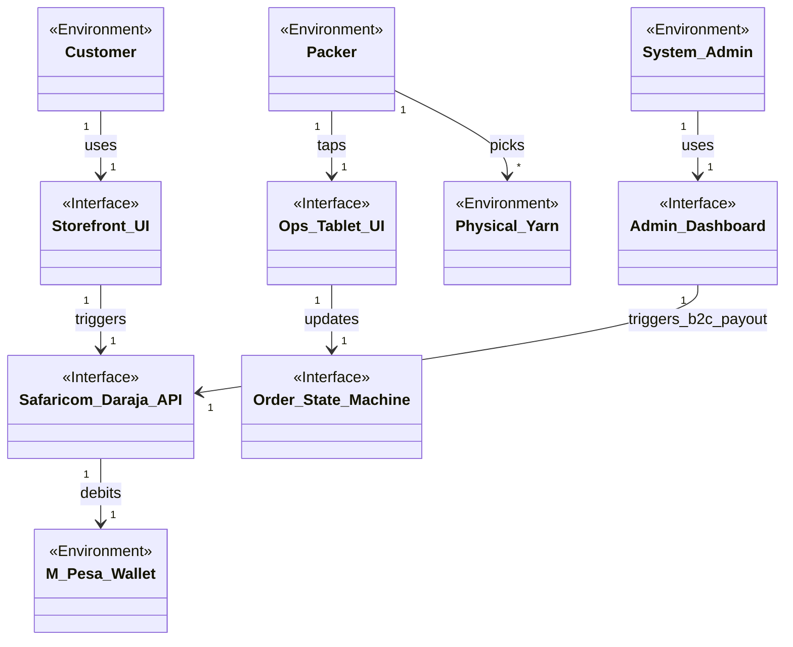
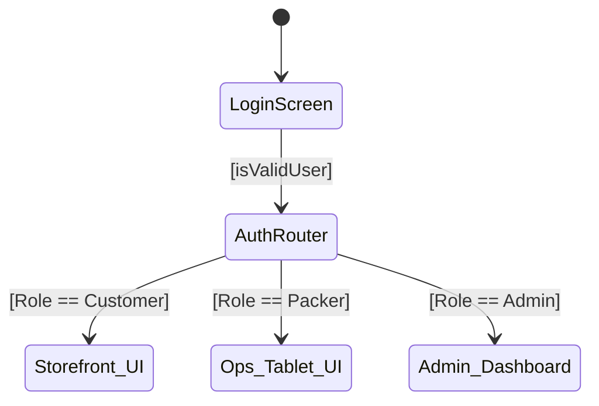
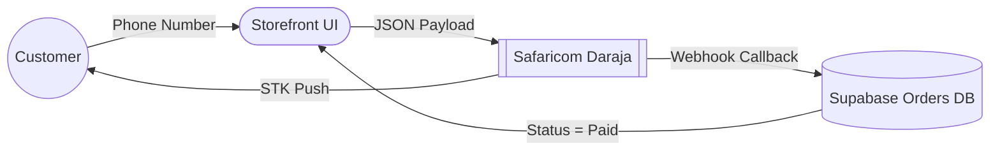
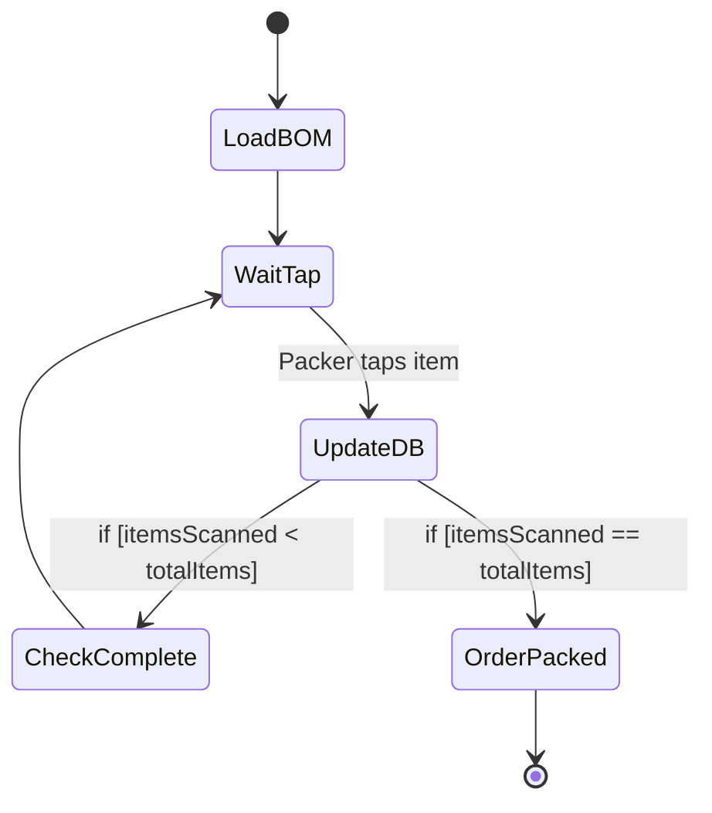
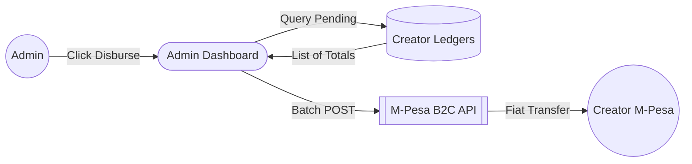

# Software Requirements Specification (SRS)
**Standard:** Adheres to ISO/IEC/IEEE 29148 Standards for Requirements Engineering
**Project:** Craft Atelier Fulfillment & E-Commerce Platform
**Date:** October 2026

---

## 1. Introduction
### 1.1 Purpose
The purpose of this document is to specify the software requirements for the Craft Atelier platform. It establishes the basis for agreement between the stakeholders and the development team regarding what the software product will do.

### 1.2 Scope
This system facilitates the sale, warehouse packing, and automated royalty disbursements for modular DIY craft kits. This SRS focuses on three rich, orthogonal core use cases representing distinct domains of the system:
1. **UC-01: Checkout & Pay** (Customer Intake & External API Integration)
2. **UC-07: Scan & Verify BOM** (Physical Warehouse Operations & Hardware UI)
3. **UC-16: Disburse Creator Royalties** (Administrative Governance & Financial Ledgers)

---

## 2. Overall Description

### 2.1 Domain Model (Specification-Level)
The domain model distinguishes between Environmental Phenomena (real-world entities) and Interface Phenomena (the software machine). 

### 2.2 User Characteristics
*   **Aspirational Beginners (Customers):** Novice crafters who easily abandon projects. They require highly intuitive mobile UI, minimal cognitive load, and instant gratification. 
*   **Warehouse Packers:** Fast-paced, physical workers wearing gloves. They require high-contrast, large-touch-target interfaces (tablets) that do not rely on precise swiping or complex text input.
*   **System Admins:** Financial and operational controllers. They require dense data visualization, bulk-action capabilities, and secure financial controls.

### 2.3 Assumptions and Dependencies
*   **Environment Assumptions:** Customers' mobile devices have internet connectivity during checkout. Packers physically place the item in the box when they tap the UI checkbox. 
*   **Dependent Systems:** The system assumes Safaricom's Daraja API (M-Pesa) guarantees exactly-once delivery of webhooks within 60 seconds of a transaction.
*   **Fidelity:** The `stock_count` integer in the database is assumed to maintain 1:1 fidelity with physical warehouse bins, verified via periodic cycle counts.

---

## 3. Specific Requirements

### 3.1 Overarching Navigation & External Interfaces
The application is governed by a role-based authentication router.

#### Annotated UI Sketches (References)
*Based on our Crazy Eights ideation, the following interfaces are finalized:*
*   **Storefront Checkout:** Output: Cart Summary. Input: 9-digit Phone field (regex validated), Pay Button (triggers Daraja STK Push).
*   **Ops Tablet Checklist:** Output: BOM List. Input: Tap Checkbox (flashes green, increments `itemsScanned`).
*   **Admin Dashboard:** Output: Sales Line Chart, Pending Payouts Table. Input: 'Disburse All' button (Triggers M-Pesa B2C batch payload).

---

### 3.2 Functional Requirements (Use Cases)

#### 3.2.1 UC-01: Checkout & Pay (Customer Domain)
**Description:** The customer pays for a physical kit using their mobile phone via M-Pesa.
**Data Flow Diagram (DFD):**

**User Story:** As a Customer, I want to enter my phone number so that I can instantly pay via M-Pesa without needing a credit card.
**Scenario (Main):** Customer enters valid phone number, receives STK push, enters PIN. System verifies the callback and confirms the order.
**Scenario (Exception):** Insufficient Funds. Daraja API callback returns failure, order is aborted, customer is prompted to retry.

#### 3.2.2 UC-07: Scan & Verify BOM (Ops Domain)
**Description:** The Warehouse Packer physically places required yarn into the shipping box.
**Activity Diagram:**

**User Story:** As a Packer, I want a digital checklist on a tablet so that I can verify every physical item without dealing with paper.
**Scenario (Main):** Packer opens pending order, taps each item on the tablet checklist, UI flashes green, order moves to PACKED.
**Scenario (Exception):** Tablet Sync Failure. Warehouse WiFi drops exactly as the Packer finishes; tablet throws offline error, forcing manual reconciliation.

#### 3.2.3 UC-16: Disburse Creator Royalties (Admin/Finance Domain)
**Description:** The Admin legally transfers fiat currency to Independent Creators for their monthly sales.
**Data Flow Diagram (DFD):**

**User Story:** As an Admin, I want to click a single button to disburse all pending royalties so that I save hours of manual bank transfers.
**Scenario (Main):** Admin clicks 'Disburse All', system calculates totals, triggers M-Pesa B2C payments, and resets Creator balances to zero.
**Scenario (Exception):** B2C Insufficient Funds. The corporate M-Pesa account lacks working capital; transactions fail and reverse.

---

### 3.3 Quality Requirements (Non-Functional)
These represent the three highest-priority quality attributes derived from the risk and Kano analyses.

**1. Reliability (Payment Integrity)**
*   **Description:** The system must never drop a successful payment webhook or create a race condition on inventory.
*   **Objective Metric:** 99.99% successful parsing of M-Pesa webhook callbacks.
*   **Fit Criteria:** The database must use Postgres Row-Level Locks (`FOR UPDATE`) during inventory deduction to prevent race conditions during concurrent checkouts.

**2. Usability (Warehouse Floor Operations)**
*   **Description:** The Ops Tablet UI must be usable by workers wearing protective/winter gloves.
*   **Objective Metric:** 0% requirement for precise swiping or typing on the warehouse floor.
*   **Fit Criteria:** All interactive elements must be minimum 48x48px capacitive touch targets (buttons/checkboxes). No text input required to fulfill an order.

**3. Performance (Real-Time Ops Sync)**
*   **Description:** The warehouse tablets must reflect order state changes instantly without manual browser refreshing.
*   **Objective Metric:** < 500ms latency between database state change and UI update.
*   **Fit Criteria:** The UI must establish a persistent WebSocket connection (`postgres_changes` listener in Supabase) to render changes in real-time.
