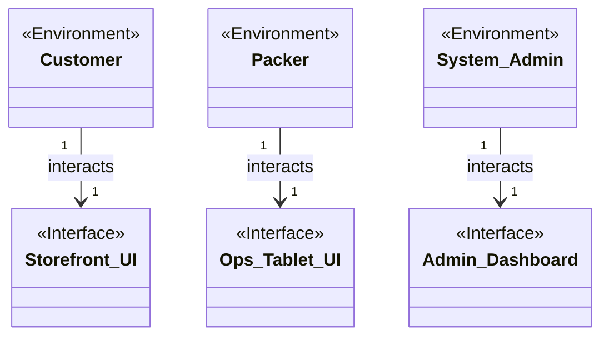
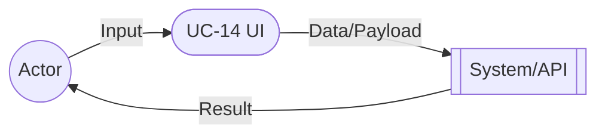
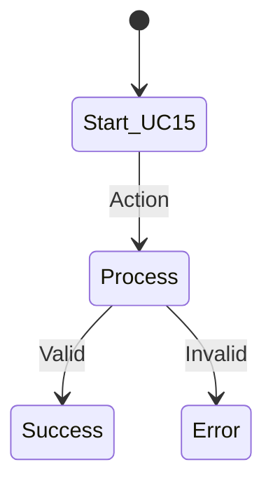

# Software Requirements Specification (SRS) - v2.0
**Standard:** Adheres to ISO/IEC/IEEE 29148 Standards for Requirements Engineering
**Project:** Craft Atelier Fulfillment & E-Commerce Platform
**Scope:** Complete 18 Core Use Cases
**Update Notes:** Mutually consistent vocabulary enforced across all artifacts. UI/UX updated to reflect Solution-Fit Interview feedback (e.g., 'SOS' renamed to 'Live Coach (Free)'; Left-Handed text micro-animations added).

---

## 1. Introduction
### 1.1 Purpose
This document specifies the software requirements for the Craft Atelier platform, acting as the definitive technical blueprint for the engineering team. 

### 1.2 Scope
This comprehensive SRS covers all 18 core use cases of the system, bridging the Storefront UI (E-Commerce), Ops Tablet UI (Warehouse), and Admin Dashboard (Governance/Finance). 

---

## 2. Overall Description

### 2.1 Domain Model & Consistent Vocabulary
The system strictly adheres to the following World-Machine boundary entities:

*   **Actors (Environment):** `Customer`, `Packer`, `Dispatcher`, `Boda Rider`, `System Admin`, `Independent Creator`, `Support Agent`, `Inventory Manager`, `HR Manager`, `Accountant`.
*   **Interfaces (Machine):** `Storefront UI`, `Ops Tablet UI`, `Admin Dashboard`, `Creator Portal`, `M-Pesa Wallet`, `Safaricom Daraja API`, `M-Pesa B2C API`, `KRA e-TIMS`, `WhatsApp Business API`.

### 2.2 Assumptions and Dependencies
*   **Environment Assumptions:** Customers possess valid M-Pesa Wallets. Packers physically move inventory when they interact with the Ops Tablet UI.
*   **Dependent Systems:** Safaricom Daraja API guarantees webhook delivery. WhatsApp Business API maintains uptime for PIN delivery.

---

## 3. Specific Requirements

### 3.1 External Interfaces & Annotated UI
Based on the Crazy Eights process and subsequent **Solution-Fit Interviews**, the UI artifacts have been fine-tuned:
*   **Storefront Checkout:** Output: Cart Summary. Input: 9-digit Phone field, Pay Button.
*   **Interactive Tutorial (Updated):** The 'SOS' button has been renamed to **'Live Coach (Free)'** to remove user fear of premium charges. The Left-Handed toggle now includes a yellow CSS micro-animation explicitly showing the text swapping "Left" to "Right".
*   **Ops Tablet Checklist:** Output: BOM List. Input: Tap Checkbox, Flag Exception button.
*   **Admin Dashboard:** Output: Sales Charts, Pending Payouts. Input: 'Disburse All' button.

---

### 3.2 Functional Requirements (All 18 Core Use Cases)

#### UC-01: Checkout & Pay
**Description:** The Customer pays for a physical kit using their mobile phone via M-Pesa.

**User Story:** As a Customer, I want to enter my phone number so that I can instantly pay via M-Pesa.

**Scenario (Main):** Customer enters valid phone number, receives STK push, enters PIN. System verifies the Safaricom Daraja API callback.

**Scenario (Exception):** Insufficient Funds. Daraja API callback returns failure, order is aborted.

---

#### UC-02: Bulk Address CSV Upload
**Description:** The HR Manager submits 50 employee addresses simultaneously.

**User Story:** As an HR Manager, I want to upload a CSV of addresses so that I can buy kits for my entire team at once.

**Scenario (Main):** HR Manager uploads CSV, system calculates bulk total, Manager pays via M-Pesa, 50 tracking IDs are generated.

**Scenario (Exception):** Payment Limit Exceeded. Bulk total exceeds M-Pesa transaction limit; transaction fails.

---

#### UC-03: Create Modular SKU
**Description:** The Independent Creator assembles a new product utilizing existing warehouse materials.

**User Story:** As an Independent Creator, I want to drag and drop raw materials into a builder so that I can publish a custom kit.

**Scenario (Main):** Creator adds yarn and hooks, COGS is calculated, margin is set, and a new Kit is published to the catalog.

**Scenario (Exception):** Discontinued Material. Creator selects a yarn color flagged as 'Discontinued' in the DB.

---

#### UC-04: View Interactive Tutorial
**Description:** The Customer watches a looping instructional video and advances when ready.

**User Story:** As a Customer, I want to watch a video loop of a single stitch so that I can master it without pausing and rewinding.

**Scenario (Main):** Customer opens tutorial, video auto-loops, and they use the 'Next Step' button to progress.

**Scenario (Exception):** Video Load Failure. CDN is down; system displays fallback static images.

---

#### UC-05: Trigger Live Coach (Free)
**Description:** The Customer receives immediate human intervention when stuck. (Updated from 'SOS Panic Button' based on Solution-Fit interviews).

**User Story:** As a Customer, I want to click 'Live Coach (Free)' so that I can get real-time video help without fearing hidden fees.

**Scenario (Main):** Customer clicks Live Coach, video pauses, Support Agent is alerted, WebRTC call resolves the issue.

**Scenario (Exception):** Camera Permissions Denied. Browser blocks WebRTC; system falls back to text chat.

---

#### UC-06: Toggle Left-Handed Mirror
**Description:** The Customer views the tutorial in a spatial orientation that matches their dominant hand.

**User Story:** As a left-handed Customer, I want to mirror the video and text so that I don't have to mentally reverse instructions.

**Scenario (Main):** Customer clicks toggle, CSS mirror transform is applied to video, text flashes yellow and swaps 'Left/Right'.

**Scenario (Exception):** Browser Incompatibility. Old browser ignores CSS transform properties.

---

#### UC-07: Scan & Verify BOM
**Description:** The Packer physically places required yarn into the shipping box.

**User Story:** As a Packer, I want a digital checklist on the Ops Tablet UI so that I can verify items without paper.

**Scenario (Main):** Packer opens pending order, taps each item on tablet, UI flashes green, order moves to PACKED.

**Scenario (Exception):** Missing Item. Packer cannot find the required hook; cannot complete checklist.

---

#### UC-08: Flag Stock Exception
**Description:** The Packer stops processing an order if an item is damaged.

**User Story:** As a Packer, I want to flag an order as damaged so that the Inventory Manager can reconcile the stock.

**Scenario (Main):** Packer clicks 'Flag Exception', selects 'Damaged', order goes ON_HOLD, Admin Dashboard alerted.

**Scenario (Exception):** System Timeout. Exception payload fails; System Admin never receives the alert.

---

#### UC-09: Batch Dispatch Orders
**Description:** The Dispatcher hands a grouped batch of packages to a Boda Rider.

**User Story:** As a Dispatcher, I want to assign multiple orders to one Boda Rider so that logistics are efficient.

**Scenario (Main):** Dispatcher selects 5 orders, assigns a Boda Rider, system sends 5 WhatsApp API alerts with Delivery PINs.

**Scenario (Exception):** WhatsApp API Ban. Meta blocks the number; Customers never receive PINs.

---

#### UC-10: Input Delivery PIN
**Description:** The Dispatcher verifies the delivery code provided by the Customer to the Boda Rider.

**User Story:** As a Dispatcher, I want to input a PIN so that the Boda Rider is authorized to hand over the package.

**Scenario (Main):** Boda Rider calls Dispatcher with PIN, Dispatcher types it into UI, system verifies, order is DELIVERED.

**Scenario (Exception):** Wrong PIN Lockout. Dispatcher enters incorrect PIN 3 times; order locks for fraud review.

---

#### UC-11: Update Business Settings
**Description:** The System Admin changes the M-Pesa routing Till number.

**User Story:** As a System Admin, I want to update the Till number so that payments route to the new Corporate Bank Account.

**Scenario (Main):** System Admin updates Till in Admin Dashboard, saves, Storefront UI cache is invalidated.

**Scenario (Exception):** Cache Invalidation Failure. Edge network fails to clear; some customers see old Till.

---

#### UC-12: Manage Global Inventory
**Description:** The Inventory Manager reconciles digital counts with physical stock.

**User Story:** As an Inventory Manager, I want to upload a CSV of physical counts so that the DB matches the warehouse.

**Scenario (Main):** Inventory Manager uploads CSV, system calculates deltas, updates DB, logs shrinkage.

**Scenario (Exception):** Concurrent Checkout. A Customer buys the last item during upload; race condition occurs.

---

#### UC-13: View Audit Logs
**Description:** The System Admin reviews historical system states.

**User Story:** As a System Admin, I want to query the order_audit_logs so that I can ensure operational integrity.

**Scenario (Main):** System Admin queries logs for an order ID, system returns chronological timeline of status changes.

**Scenario (Exception):** Query Timeout. Admin tries to load 5 years of logs at once; DB terminates query.

---

#### UC-14: Generate Tax CSV
**Description:** The Accountant exports data formatted for KRA e-TIMS compliance.

**User Story:** As an Accountant, I want to export a KRA-compliant CSV so that I can easily file corporate taxes.

**Scenario (Main):** Accountant selects month, clicks export, system formats data to KRA e-TIMS schema.

**Scenario (Exception):** Schema Mismatch. KRA adds a new mandatory column; generated CSV is rejected.

---

#### UC-15: View Royalty Dashboard
**Description:** The Independent Creator monitors their financial success.

**User Story:** As an Independent Creator, I want to view my sales chart so that I can track my marketing performance.

**Scenario (Main):** Creator logs into Creator Portal, views 30-day line chart and Pending Payout balance.

**Scenario (Exception):** RLS Failure. Creator's JWT token expires; dashboard loads blank.

---

#### UC-16: Disburse Royalties
**Description:** The System Admin transfers fiat currency to Creators via M-Pesa B2C.

**User Story:** As a System Admin, I want to click 'Disburse All' so that all Creators are paid instantly.

**Scenario (Main):** System Admin clicks Disburse All, system triggers M-Pesa B2C API, resets balances to zero.

**Scenario (Exception):** B2C Insufficient Funds. Corporate M-Pesa account lacks working capital.

---

#### UC-17: Review Support Escalations
**Description:** The Support Agent resolves customer complaints.

**User Story:** As a Support Agent, I want to view the chronological order history so that I can find missing packages.

**Scenario (Main):** Support Agent opens ticket, views history and assigned Packer, resolves the complaint.

**Scenario (Exception):** Angry Customer Hangs Up. Customer disconnects WebRTC call before Agent gathers order ID.

---

#### UC-18: Process Refund
**Description:** The Support Agent processes a fiat refund to the Customer.

**User Story:** As a Support Agent, I want to trigger the M-Pesa B2C API so that I can refund an unhappy Customer.

**Scenario (Main):** Support Agent inputs refund, triggers M-Pesa B2C API, funds returned, Creator ledger adjusted.

**Scenario (Exception):** API Failure. M-Pesa B2C API is down; refund sits in Pending queue.

---

### 3.3 Quality Requirements (Non-Functional)
1. **Reliability:** 99.99% successful parsing of Safaricom Daraja API callbacks. Database must use Row-Level Locks.
2. **Usability:** Ops Tablet UI must be usable by gloved Packers (48x48px minimum touch targets).
3. **Performance:** Sub-500ms real-time UI synchronization via WebSockets for the Ops Tablet UI and Admin Dashboard.
