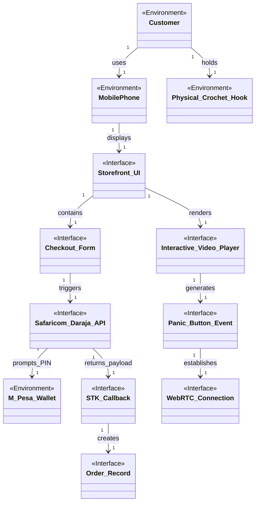

# Domain Model 1: E-Commerce & Intake

This sub-model focuses on the Customer's interaction with the storefront, the payment process, and the interactive tutorial.

## Domain Model Diagram

## Entity Descriptions

### Environmental Phenomena
*   **`Customer`**: The real-world human actor initiating the purchase and attempting to learn the craft.
*   **`MobilePhone`**: The physical hardware device possessed by the customer.
*   **`M_Pesa_Wallet`**: The external financial construct holding the customer's fiat currency.
*   **`Physical_Crochet_Hook`**: The real-world tool the customer manipulates while watching the tutorial.

### Interface Phenomena
*   **`Storefront_UI`**: The digital webpage rendered in the browser.
*   **`Checkout_Form`**: The specific UI component collecting the customer's phone number and delivery details.
*   **`Safaricom_Daraja_API`**: The external API gateway the system talks to for payments.
*   **`STK_Callback`**: The JSON payload received by our servers indicating payment success/failure.
*   **`Order_Record`**: The database row created when a payment succeeds.
*   **`Interactive_Video_Player`**: The DOM element playing the looping tutorial.
*   **`Panic_Button_Event`**: The DOM click event generated when the user needs SOS help.
*   **`WebRTC_Connection`**: The P2P audio/video stream established between the customer and support.

## Association Descriptions
*   **`Customer -> MobilePhone (uses)`**: The human actor physically interacts with their device.
*   **`Storefront_UI -> Interactive_Video_Player (renders)`**: The UI loads the video player into the DOM.
*   **`Checkout_Form -> Safaricom_Daraja_API (triggers)`**: Submitting the form fires an HTTP POST to Safaricom.
*   **`Safaricom_Daraja_API -> M_Pesa_Wallet (prompts_PIN)`**: The API physically forces the customer's phone to show a PIN prompt.
*   **`STK_Callback -> Order_Record (creates)`**: A successful webhook payload results in a database INSERT.
*   **`Panic_Button_Event -> WebRTC_Connection (establishes)`**: Clicking SOS instantly opens a live connection to the Ops Hub.
