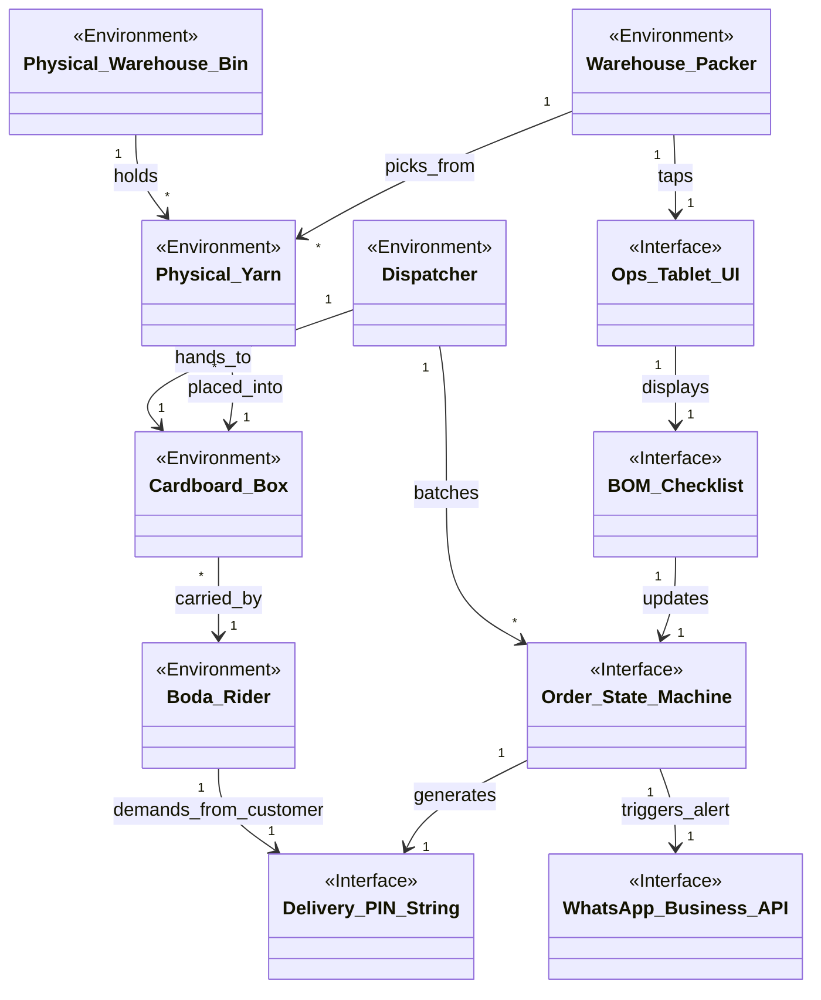

# Domain Model 2: Warehouse Operations & Dispatch

This sub-model focuses on the physical fulfillment of orders, the packing tablets, and the Boda Boda dispatch logistics.

## Domain Model Diagram

## Entity Descriptions

### Environmental Phenomena
*   **`Warehouse_Packer`**: The physical employee collecting items.
*   **`Boda_Rider`**: The courier motorcycle rider executing the delivery.
*   **`Dispatcher`**: The warehouse manager assigning boxes to riders.
*   **`Physical_Warehouse_Bin`**: The wooden/metal shelf holding raw materials.
*   **`Cardboard_Box`**: The physical shipping container.
*   **`Physical_Yarn`**: The tangible product being sold.

### Interface Phenomena
*   **`Ops_Tablet_UI`**: The digital touchscreen interface used on the warehouse floor.
*   **`BOM_Checklist`**: The specific UI component rendering the required items for a kit.
*   **`Order_State_Machine`**: The database logic transitioning orders from PENDING -> PACKED -> DISPATCHED.
*   **`Delivery_PIN_String`**: The 4-digit token generated by the database for chain of custody.
*   **`WhatsApp_Business_API`**: The external service used to push the PIN to the customer's phone.

## Association Descriptions
*   **`Warehouse_Packer -> Physical_Yarn (picks_from)`**: The physical act of taking inventory off a shelf.
*   **`Warehouse_Packer -> Ops_Tablet_UI (taps)`**: The human input event registering progress on the screen.
*   **`BOM_Checklist -> Order_State_Machine (updates)`**: Completing the checklist forces the database to change the order status.
*   **`Order_State_Machine -> Delivery_PIN_String (generates)`**: Changing status to 'Dispatched' mathematically generates the token.
*   **`Order_State_Machine -> WhatsApp_Business_API (triggers_alert)`**: The system automatically pushes a network request to Meta when dispatched.
*   **`Boda_Rider -> Delivery_PIN_String (demands_from_customer)`**: The physical blocker where the rider refuses to release the box without the token.
