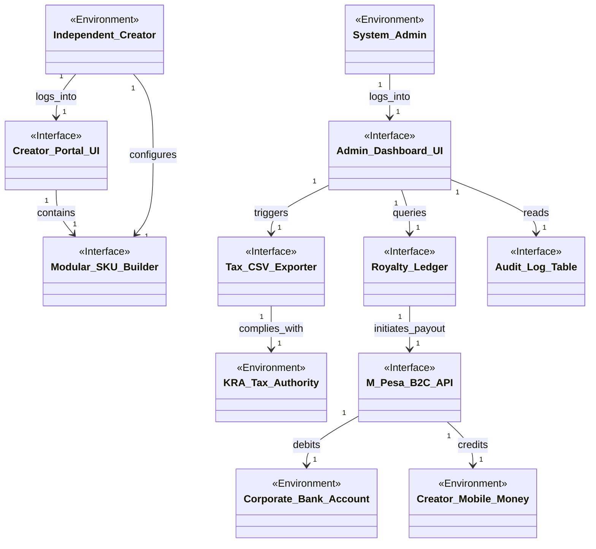

# Domain Model 3: Admin, Creator SKUs & Finance

This sub-model focuses on governance, royalty payouts, catalog creation, and tax compliance.

## Domain Model Diagram

## Entity Descriptions

### Environmental Phenomena
*   **`System_Admin`**: The business owner managing operations.
*   **`Independent_Creator`**: The external partner designing kits.
*   **`KRA_Tax_Authority`**: The Kenya Revenue Authority government body.
*   **`Corporate_Bank_Account`**: The real-world bank vault holding the company's fiat currency.
*   **`Creator_Mobile_Money`**: The Creator's personal M-Pesa account.

### Interface Phenomena
*   **`Admin_Dashboard_UI`**: The high-privilege web interface for governance.
*   **`Creator_Portal_UI`**: The RLS-secured web interface for creators.
*   **`Modular_SKU_Builder`**: The drag-and-drop JSON configuration tool.
*   **`Royalty_Ledger`**: The database table (`creator_payouts`) calculating owed margins.
*   **`M_Pesa_B2C_API`**: Safaricom's Business-to-Customer payment gateway.
*   **`Tax_CSV_Exporter`**: The internal ETL script formatting sales data.
*   **`Audit_Log_Table`**: The immutable `order_audit_logs` tracking chronological changes.

## Association Descriptions
*   **`Independent_Creator -> Modular_SKU_Builder (configures)`**: The Creator defines the new product.
*   **`Admin_Dashboard_UI -> Royalty_Ledger (queries)`**: The UI fetches the aggregated sums of owed money.
*   **`Royalty_Ledger -> M_Pesa_B2C_API (initiates_payout)`**: The software sends a secure POST request to transfer funds.
*   **`M_Pesa_B2C_API -> Corporate_Bank_Account (debits)`**: The API physically removes fiat from the company.
*   **`M_Pesa_B2C_API -> Creator_Mobile_Money (credits)`**: The API physically adds fiat to the partner.
*   **`Tax_CSV_Exporter -> KRA_Tax_Authority (complies_with)`**: The generated file structurally matches the government's legal schema constraints.
