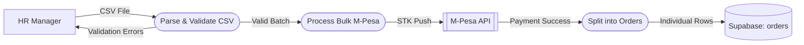

# UC-02: Bulk Address CSV Upload

## Data Flow Diagram (DFD)

## Justification
A **Data Flow Diagram (DFD)** is used because this is a heavy data-transformation task (converting a single CSV into 50 distinct database rows and triggering a bulk payment API).
## Process Descriptions
- **Parse & Validate CSV**: Ensures phone numbers and addresses meet schema requirements.
- **Process Bulk M-Pesa**: Requests a single large payment from the HR Manager.
- **Split into Orders**: Transforms the batch array into distinct delivery tracking IDs in the DB.
