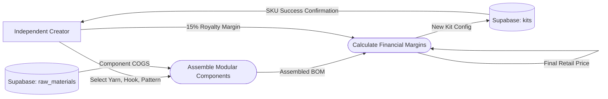

# UC-03: Create Modular SKU

## Data Flow Diagram (DFD)

## Justification for DFD over Activity Diagram
A **Data Flow Diagram** was chosen over an Activity Diagram because managing modular SKUs is fundamentally an aggregation of data from various sources to assemble a final composite product. While an Activity Diagram shows *how* the user clicks through the web page, a DFD clearly shows *where* the dependencies lie, mapping out the flow of data from the raw materials database, through the pricing engine, and finally resting in the main kits catalog database.

## Process/Node Descriptions
- **Independent Creator**: The user providing the configuration data for the new kit.
- **Assemble Modular Components ([Process])**: Ingests configuration data and fetches component costs from the raw materials database.
- **Calculate Financial Margins ([Process])**: Computes the dynamic final retail price based on the selected modules (COGS) plus the Creator's royalty percentage.
- **Supabase raw_materials ([(Data Store)])**: The source database containing individual physical parts and their wholesale costs.
- **Supabase kits ([(Data Store)])**: The sink database where the newly assembled modular SKU (the BOM) is stored for customers to buy.
