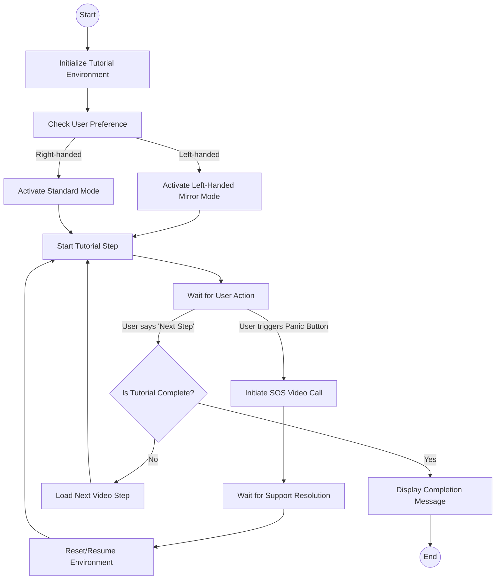

# UC-04: Interactive Tutorial (Including Panic Button and Left-Handed Mirror)

## Activity Diagram

## Diagram Justification: Activity Diagram vs. Data Flow Diagram
An **Activity Diagram** was chosen over a Data Flow Diagram (DFD) for this use case because the Interactive Tutorial is fundamentally driven by **control flow**, **user state changes**, and **decision points** (such as checking handedness or triggering an SOS interrupt). 
- An **Activity Diagram** perfectly models the step-by-step execution, branching logic, and sequential actions required to navigate the tutorial interface.
- A **Data Flow Diagram**, on the other hand, focuses on how data moves through a system (sources, sinks, and transformations) and does not effectively capture the order of operations, interactive loops, or immediate UI state changes (like the Panic Button interrupting the normal flow).

## Activity Descriptions
- **Initialize Tutorial Environment**: Sets up the basic UI, loads the video array, and prepares the learning modules.
- **Check User Preference**: Evaluates user settings to determine the spatial orientation of the tutorial interface.
- **Activate Left-Handed Mirror Mode**: Applies CSS transformations to flip the video player and swaps directional text for left-handed users.
- **Activate Standard Mode**: Keeps the default UI layout for right-handed users.
- **Start Tutorial Step**: Auto-loops the current video step for the user.
- **Wait for User Action**: The system listens for touch inputs or voice commands (e.g., "Next Step").
- **Initiate SOS Video Call**: Activated via the "Panic Button", this immediately halts the video and opens a WebRTC connection to the Ops Hub.
- **Wait for Support Resolution**: The user gets live help to fix their dropped stitch.
- **Load Next Video Step**: Advances the user to the subsequent lesson or task in the tutorial.
- **Display Completion Message**: Congratulates the user upon finishing all steps successfully, triggering the final gamification reward.
