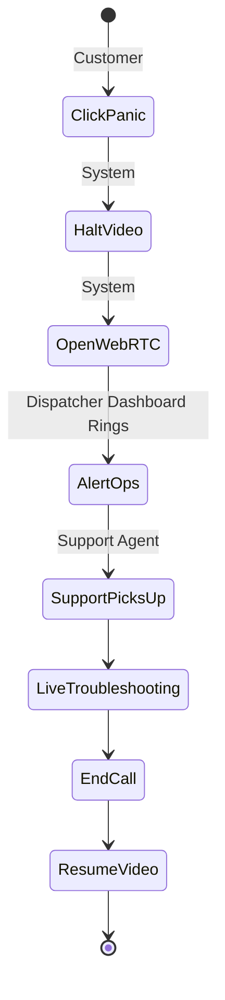

# UC-05: Trigger Panic Button SOS

## Activity Diagram

## Justification
An **Activity Diagram** is used because this is an interrupt-driven control flow (pausing an active task, establishing a synchronous human connection, and then resuming).
## Process Descriptions
- **HaltVideo**: The tutorial stops automatically to prevent the user from getting further lost.
- **AlertOps**: A loud notification pings the Ops Hub.
- **LiveTroubleshooting**: A 5-minute WebRTC video session to fix the dropped stitch.
