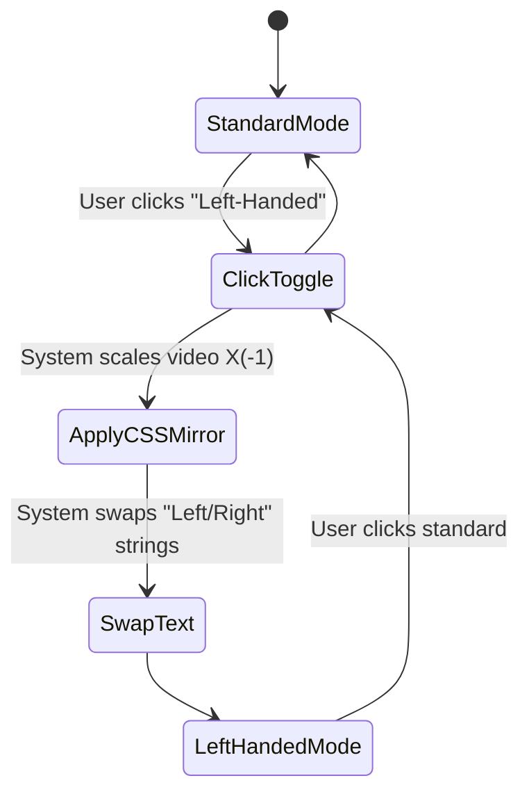

# UC-06: Toggle Left-Handed Mirror

## Activity Diagram

## Justification
An **Activity Diagram** models this best because it represents a strict state change in the UI layer driven by user control.
## Process Descriptions
- **ApplyCSSMirror**: Reverses the video feed horizontally so right-handed instructors look left-handed.
- **SwapText**: A regex function that dynamically alters the pattern instructions to prevent cognitive dissonance.
