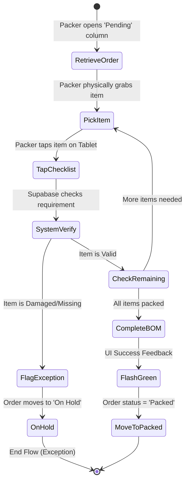

# UC-07: Scan & Verify BOM

## Activity Diagram

## Justification: Activity Diagram vs. Data Flow Diagram
An **Activity Diagram** was chosen for UC-07 because this use case heavily focuses on the physical and sequential **control flow** of a human Packer interacting with a tablet. A Data Flow Diagram (DFD) maps how data moves through a system, but it struggles to capture conditional logic, looping (repeatedly picking and scanning items until the BOM is fulfilled), and physical human interactions (flagging exceptions). 

## Process Descriptions
- **RetrieveOrder**: The Packer pulls up the Bill of Materials for the assigned order on their tablet.
- **PickItem**: The physical action where the Packer selects yarn/hardware from the warehouse bins.
- **TapChecklist**: The Packer taps the touchscreen to input the item's verification into the system.
- **FlagException**: The process for resolving an incorrect item (e.g., notifying Admin that black yarn is out of stock).
- **CheckRemaining**: Loop evaluation if there are still outstanding items on the BOM.
- **CompleteBOM**: Finalizing the packing process once all BOM items are correctly tapped and matched.
