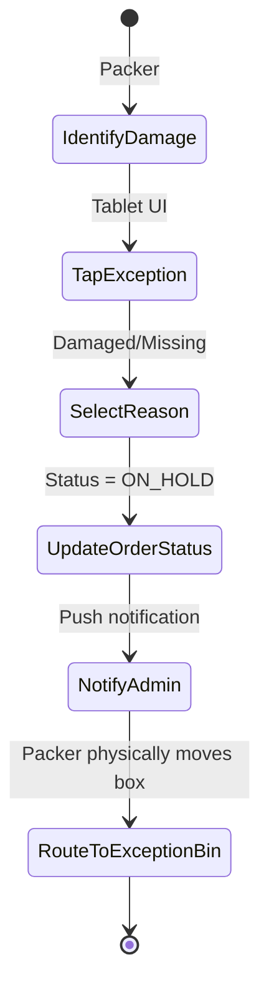

# UC-08: Flag Stock Exception

## Activity Diagram

## Justification
An **Activity Diagram** is used because it models a physical warehouse exception flow, breaking the standard loops and requiring manual intervention from a different actor.
## Process Descriptions
- **IdentifyDamage**: Human visual QA on the yarn.
- **UpdateOrderStatus**: Stops the order from moving to the Dispatcher's queue.
- **RouteToExceptionBin**: The physical separation of the defective order.
