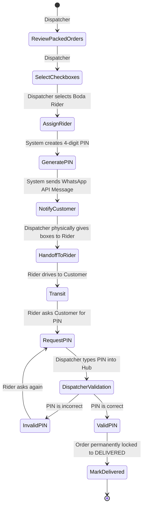

# UC-09: Batch Dispatch & Delivery PIN

## Activity Diagram

## Justification: Activity Diagram vs. Data Flow Diagram
An **Activity Diagram** is the optimal choice for UC-09 because it involves complex chronological handoffs between multiple human actors (the Dispatcher, the System, the Boda Rider, and the Customer). While a DFD would only show the data passing between these entities, an Activity Diagram effectively models the operational workflow, illustrating exactly *who* is responsible for *what* step and the sequence of those physical responsibilities (like refusing to hand over the box until the PIN is verified).

## Process Descriptions
- **ReviewPackedOrders**: The Dispatcher evaluates orders that are taped shut and ready for delivery.
- **SelectCheckboxes**: The Dispatcher logically groups multiple orders based on neighborhood routes.
- **AssignRider**: The Dispatcher assigns the batch to a specific Boda Rider from a dropdown list.
- **GeneratePIN**: The system creates the secure chain-of-custody token.
- **NotifyCustomer**: The system automatically sends a WhatsApp alert to the Customer so they know the rider is en route.
- **HandoffToRider**: The physical collection of the batch from the warehouse.
- **RequestPIN / DispatcherValidation**: The loop where the Boda rider calls the Dispatcher to verify the customer's PIN before releasing the physical goods.
