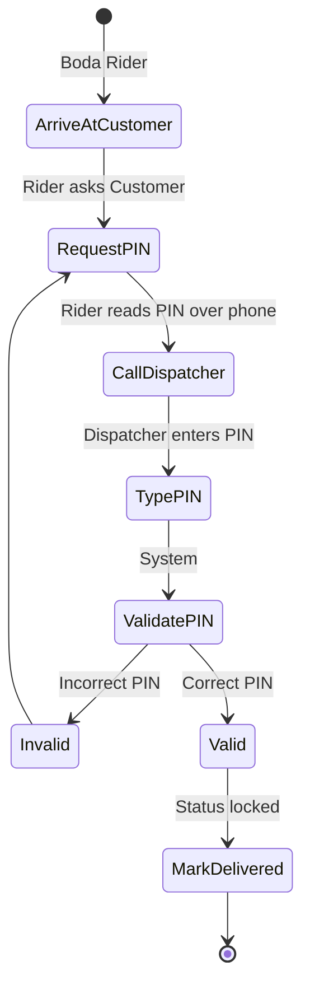

# UC-10: Input Delivery PIN

## Activity Diagram

## Justification
An **Activity Diagram** is necessary because it relies on a multi-actor chronological verification loop that refuses to proceed until a strict condition (valid PIN) is met.
## Process Descriptions
- **RequestPIN**: The physical handoff blocker.
- **ValidatePIN**: The backend check ensuring the provided PIN matches the `delivery_pin` column in Supabase.
