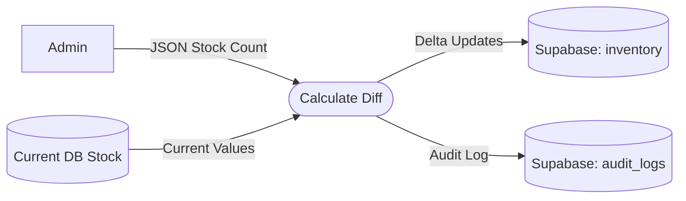

# UC-12: Manage Global Inventory

## Data Flow Diagram (DFD)

## Justification
A **Data Flow Diagram** is required for inventory reconciliation because it involves pulling existing state, computing a differential (delta), and updating the single source of truth.
## Process Descriptions
- **Calculate Diff**: The system compares the physical count uploaded by the Admin against the digital count to find shrinkage.
