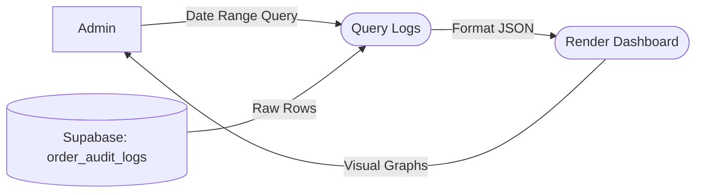

# UC-13: View Financial & Audit Logs

## Data Flow Diagram (DFD)

## Justification
A **Data Flow Diagram** shows the direct lineage of read-only data from the database, through a formatting parser, to the visualization layer.
## Process Descriptions
- **Query Logs**: A secure SQL query restricted by the Admin's requested date parameters.
- **Render Dashboard**: Converts raw timestamped status changes into human-readable tables.
