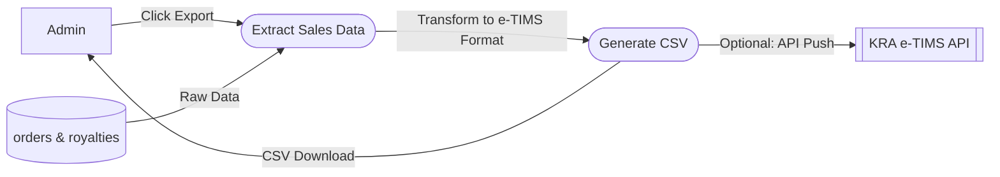

# UC-14: Generate Tax Compliance CSV

## Data Flow Diagram (DFD)

## Justification
A **Data Flow Diagram** models the exact ETL (Extract, Transform, Load) pipeline required for legal tax compliance formatting.
## Process Descriptions
- **Transform to e-TIMS Format**: Maps our internal database columns (e.g., `subtotal_cents`) to the exact header requirements mandated by the Kenya Revenue Authority.
