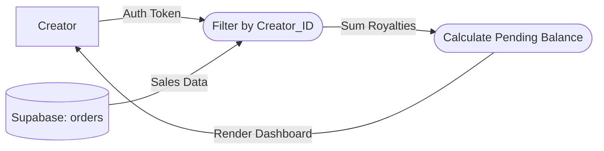

# UC-15: View Royalty Dashboard

## Data Flow Diagram (DFD)

## Justification
A **Data Flow Diagram** ensures that data leakage does not occur, explicitly showing the filter layer that prevents Creator A from seeing Creator B's sales data.
## Process Descriptions
- **Filter by Creator_ID**: A Row Level Security (RLS) enforcement step ensuring data privacy.
- **Calculate Pending Balance**: Sums all un-disbursed orders.
