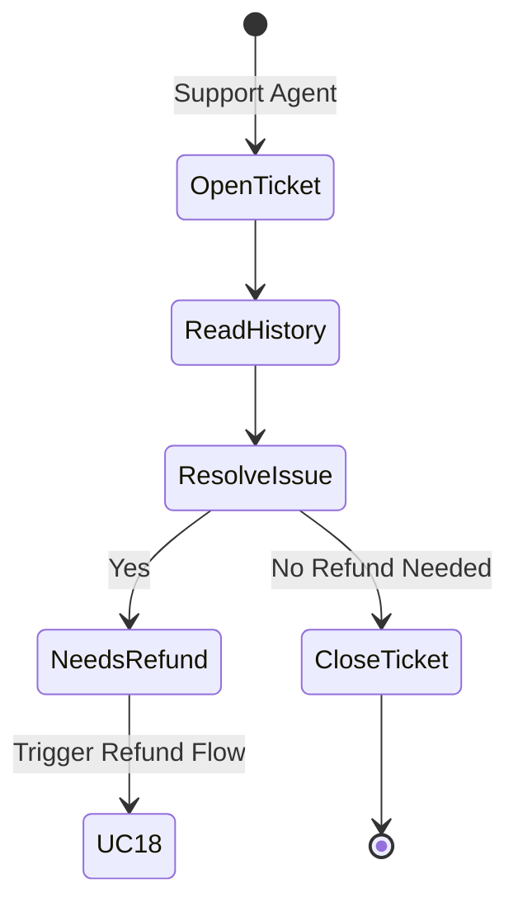

# UC-17: Review Support Escalations

## Activity Diagram

## Justification
An **Activity Diagram** accurately models the triage branching logic of a support desk (escalating to refunds vs. standard closures).
## Process Descriptions
- **ReadHistory**: Loading the customer's previous order and chat history.
- **Trigger Refund Flow**: A logical handoff to the financial system (UC-18).
