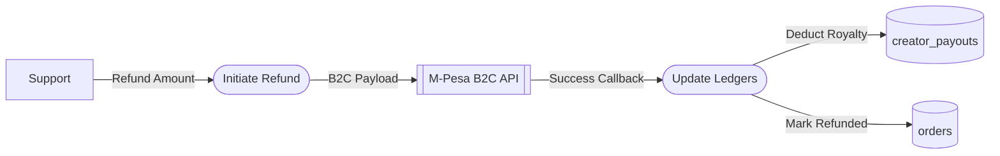

# UC-18: Process Customer Refund

## Data Flow Diagram (DFD)

## Justification
A **Data Flow Diagram** is critical here because refunding money alters multiple ledgers (deducting from the company AND deducting from the Creator's future payout).
## Process Descriptions
- **Initiate Refund**: Triggers the outbound money transfer to the customer.
- **Update Ledgers**: Ensures the Creator is not paid a royalty for a refunded item.
